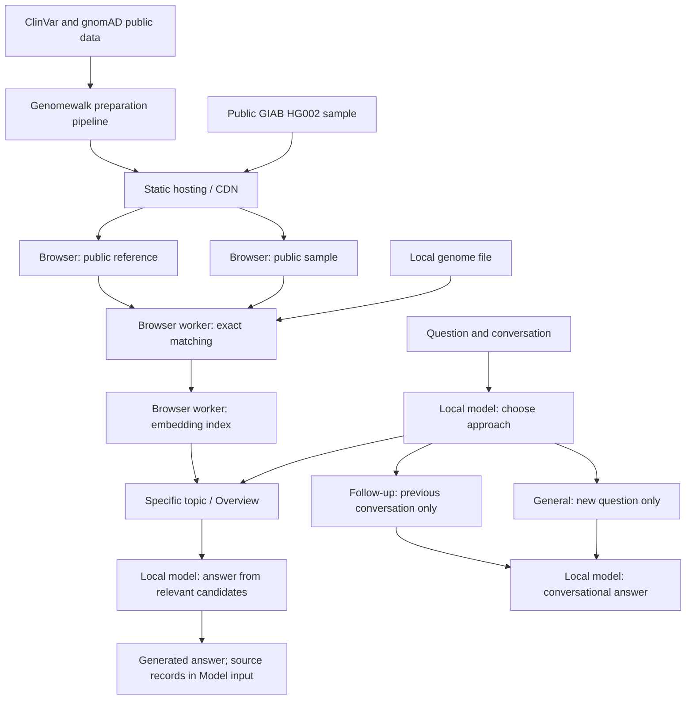

# Architecture

## Static delivery, local computation

The hosting layer serves files only. Neither an uploaded genome nor a question is posted to it. Public downloads contain fixed reference or model URLs; they do not encode a user's matches. Clicking a source link opens that external resource explicitly.

## Preparation

The main thread owns UI state. A genome worker reads the browser `File`, identifies its build/format and hashes its complete bytes. VCF calls use exact chromosome, position, REF and ALT matching. Consumer exports use Genomewalk's original container/parser/build checks and rsID sidecars. VCF build detection follows Genomewalk's reference declarations and chromosome lengths. Its filter policy accepts `PASS` or `.` (filters not applied) and retains the original value. Named failed filters, missing/unsupported genotypes and contradictory duplicate calls are excluded before AI use.

Genomewalk's streaming reader checks the public catalog's compressed size, SHA-256, BGZF blocks, header, row count and ordering. A second verified pass reads annotations for matched alleles only. Consumer lookup hashes and catalog bindings are checked before matching. Equivalent indel representations are not normalized; absence of a match is not an absence-of-disease result.

Completed matches can be stored in this browser's localStorage. The cache contains personal matched calls, so it is private local data, not encrypted storage. Changing the file, reference fingerprint or matching version invalidates reuse. Full genomes and conversations are not persisted by this cache. The UI provides a way to forget saved matches.

`Xenova/all-MiniLM-L6-v2`, pinned in `src/config/embeddings.ts`, embeds public annotation text for the matches. It runs through Transformers.js on WASM, using q8 weights, mean pooling and normalized 384-dimensional vectors. Documents are tokenizer-limited to 256 tokens. Vectors remain in memory and are rebuilt after refresh. No answer model loads until the user chooses one.

## Each question

The shared planner prompt returns one of four categories: `search` (Specific topic, with a standalone query), `overview` (Overview), `other` (General), or `followup` (Follow-up). It sees recent conversation to resolve the latest subject. There is no keyword routing or gene/disease exception.

The response grammar excludes `followup` when no complete earlier exchange fits the planner input. Conversation budgeting admits whole question/answer pairs, newest first; it never clips an answer to fill the remaining space.

Specific topic ranks the whole match pool by semantic similarity; Overview uses catalog classification, review stars and catalog order. Each sends at most three whole candidate records, without prior conversation. One answer call uses only relevant supplied records, including fewer or none. There is no selector call. The three-record input cap is enforced by code; following the supplied evidence is a prompt instruction, not a guarantee.

Follow-up skips retrieval and receives only the latest question, genome provenance and the newest complete Q&A turns that fit. No separate source records are retained in conversation history or sent on this path. Previously omitted facts are unavailable, and earlier model errors can be carried forward. General receives only the new question and shared instructions. The planner still sees history when a new subject starts; the fresh answer does not.

The answer payload keeps source facts, labels and URLs but omits the redundant current-record origin, repeated context note and source IDs already present in URLs. Shared evidence limitations stay in the system prompt. Original supplied fields remain inspectable in Model input. The chat displays the generated answer without appended record cards. Answer calls have a 2,048-token allowance. Empty or unfinished record-based answers fail visibly and do not enter history. Qwen3.5 9B now uses a 32,768-token browser window to reduce allocation pressure after GPU-device failures at larger windows; this does not guarantee sufficient memory on every device.

The record-answer prompt requests a brief introduction followed by linked gene/variant headings and labelled facts. ClinVar and gnomAD links sit beside the facts they support; publications share a wrapping paragraph rather than a vertical Sources list. Genomewalk's unchanged publication reader adds its prepared author/journal/year labels from verified static shards, with PMID links as the fallback. There are no runtime PubMed API calls, paper titles or abstracts. The same labels enter the answer context and source inspector. This is model-generated presentation, not a fixed field layout; explicit user formatting requests take precedence. All answer modes share one source-link instruction: use available URLs from supplied records or earlier conversation, preserve citation labels and URL associations, and never invent links. Follow-ups retain their brief-answer style while reusing earlier links. The UI renders Markdown without inserting or rewriting citations.

Model profiles select compatible weights/WASM, context sizes and supported inference settings. Shared prompts and application behavior stay outside model profiles. One answer model is loaded at a time.

Public weights and compiled model libraries download from their configured hosts. Those hosts receive ordinary download requests, not inference requests. Model files may be cached; offline availability depends on those caches and browser storage policies. No analytics or cloud inference service is configured.
