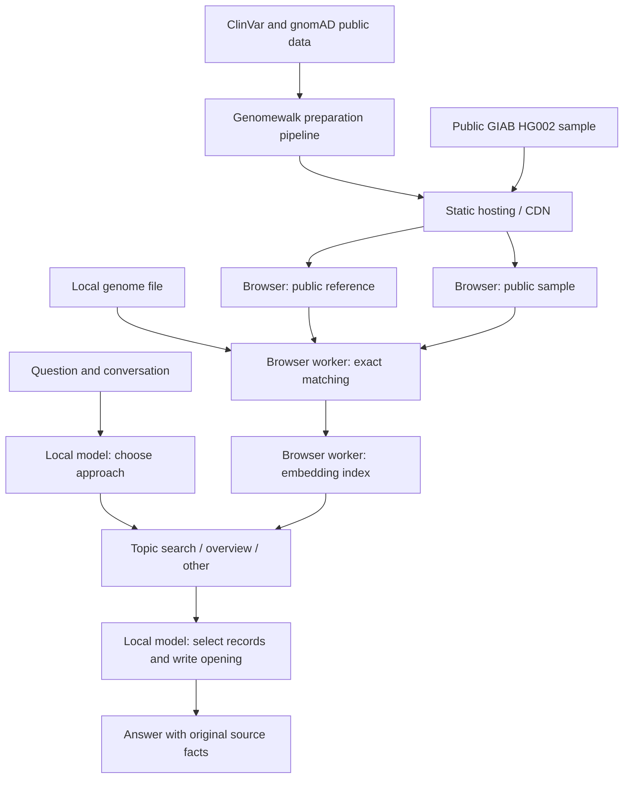

# Architecture

## Static delivery, local computation

The hosting layer serves files only. Neither an uploaded genome nor a question is posted to it. Public downloads contain fixed reference or model URLs; they do not encode a user's matches. Clicking a source link opens that external resource explicitly.

## Preparation

The main thread owns UI state. A genome worker reads the browser `File`, identifies its build/format and hashes its complete bytes. VCF calls use exact chromosome, position, REF and ALT matching. Consumer exports use Genomewalk's original container/parser/build checks and rsID sidecars. VCF build detection follows Genomewalk's reference declarations and chromosome lengths. Its filter policy accepts `PASS` or `.` (filters not applied) and retains the original value. Named failed filters, missing/unsupported genotypes and contradictory duplicate calls are excluded before AI use.

Genomewalk's streaming reader checks the public catalog's compressed size, SHA-256, BGZF blocks, header, row count and ordering. A second verified pass reads annotations for matched alleles only. Consumer lookup hashes and catalog bindings are checked before matching. Equivalent indel representations are not normalized; absence of a match is not an absence-of-disease result.

Completed matches can be stored in this browser's localStorage. The cache contains personal matched calls, so it is private local data, not encrypted storage. Changing the file, reference fingerprint or matching version invalidates reuse. Full genomes and conversations are not persisted by this cache. The UI provides a way to forget saved matches.

`Xenova/all-MiniLM-L6-v2`, pinned in `src/config/embeddings.ts`, embeds public annotation text for the matches. It runs through Transformers.js on WASM, using q8 weights, mean pooling and normalized 384-dimensional vectors. Documents are tokenizer-limited to 256 tokens. Vectors remain in memory and are rebuilt after refresh. No answer model loads until the user chooses one.

## Each question

The same shared planner prompt serves every supported answer model. It returns exactly one of three categories:

| Category                  | Action                                                                                                |
| ------------------------- | ----------------------------------------------------------------------------------------------------- |
| Specific topic (`search`) | Produce a self-contained search query from the latest question and conversation.                      |
| All matches (`overview`)  | Order the full usable pool without semantic filtering.                                                |
| Other (`other`)           | Explain general concepts or clarify an unclear request using the conversation, without new retrieval. |

For a topic, every usable record gets a cosine similarity score. Classification and review are included before selecting any shortlist:

`score = similarity + 0.15 × class value + 0.04 × (review stars / 4)`

The weights are visible and adjustable. Exact prepared catalog codes map to class values: P/PLP = 1, LP = 0.75, C = 0.5, O = 0.25; unknown = 0. These are application review priorities, not calibrated risk probabilities. There is no second reranking model and no gene-specific exception. An overview uses classification, review stars and the stable catalog order; it cannot establish the user's greatest health risk.

Up to three new records are included in the answer input. Context assembly admits complete records and the newest complete conversation turns that fit the selected model's budget; it does not summarize away original evidence. Prior assistant prose can resolve a follow-up, but cannot introduce new source facts.

A constrained local inference call selects record IDs from the supplied reference. Invalid or unfinished selections fail visibly. A second local call writes a brief opening from selected records only. Source details are then rendered from original fields, preserving calls, classifications, frequencies and links. Generated prose is not repaired with keyword filters. This preserves source values but does not guarantee that the generated opening is correct.

The `Other` path uses a shared general-answer prompt and conversation context. It does not demand a personal genome to define a genetics concept.

## Model and network boundaries

WebLLM runs the answer model inside a browser worker using WebGPU. Model profiles select compatible weights/WASM, context sizes and supported inference settings. Shared prompts and application behavior stay outside model profiles. One answer model is loaded at a time.

Public weights and compiled model libraries download from their configured hosts. Those hosts receive ordinary download requests, not inference requests. Model files may be cached; offline availability depends on those caches and browser storage policies. No analytics or cloud inference service is configured.
