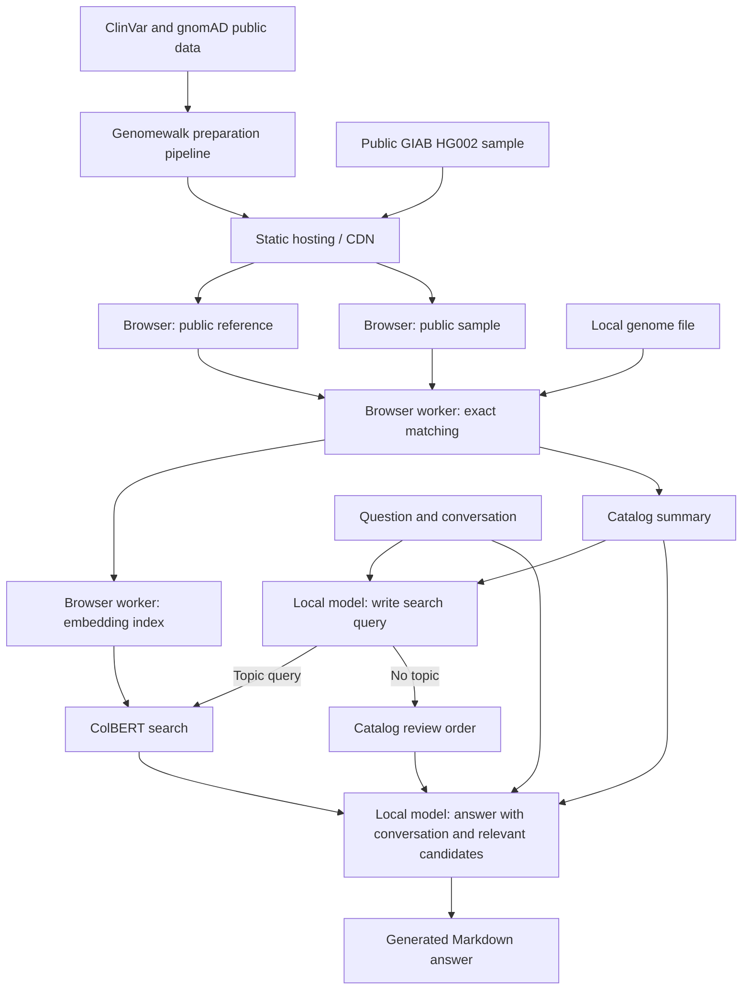

# Architecture

## Static delivery, local computation

The hosting layer serves files only. Neither an uploaded genome nor a question is posted to it. Public downloads contain fixed reference or model URLs; they do not encode a user's matches. Clicking a source link opens that external resource explicitly.

## Preparation

The main thread owns UI state. A genome worker reads the browser `File`, identifies its build/format and hashes its complete bytes. VCF calls use exact chromosome, position, REF and ALT matching. Consumer exports use Genomewalk's original container/parser/build checks and rsID sidecars. VCF build detection follows Genomewalk's reference declarations and chromosome lengths. Its filter policy accepts `PASS` or `.` (filters not applied) and retains the original value. Named failed filters, missing/unsupported genotypes and contradictory duplicate calls are excluded before AI use.

Genomewalk's streaming reader checks the public catalog's compressed size, SHA-256, BGZF blocks, header, row count and ordering. A second verified pass reads annotations for matched alleles only. Consumer lookup hashes and catalog bindings are checked before matching. Equivalent indel representations are not normalized; absence of a match is not an absence-of-disease result.

Completed matches can be stored in this browser's localStorage. The cache contains personal matched calls, so it is private local data, not encrypted storage. Changing the file, reference fingerprint or matching version invalidates reuse. Full genomes and conversations are not persisted by this cache. The UI provides a way to forget saved matches.

`answerdotai/answerai-colbert-small-v1`, pinned in `src/config/embeddings.ts`, embeds public annotation text for the matches. Its publisher-supplied root `model.onnx` includes the trained projection to 96 dimensions; the similarly named file in `onnx/` contains only the backbone. The app runs the complete FP32 export through Transformers.js on a CPU/WASM worker, independently of the answer model's GPU. The initial model download is about 133 MB and is browser-cached.

`src/lib/colbert.ts` follows the checkpoint's standard ColBERT method: query/document marker tokens, a 300-token document cap, queries expanded to 32 positions with masked attention, document punctuation excluded from scoring, and individually normalized token vectors. Native MaxSim sums each query token's best document-token similarity. There is no mean pooling, lexical blend, identifier override, score threshold or classification bonus. Token vectors remain in memory and are rebuilt after refresh. No answer model loads until the user chooses one.

## Each question

The browser builds a summary when preparing or restoring a genome. All counts describe the usable catalog matches. The summary lists the total variants, distinct named genes, variants missing a gene, distinct listed condition or trait names, primary classifications, review stars, review-priority groups, overlapping categories, and counts with an overall gnomAD frequency or a linked publication.

The summary starts with the first three variants by Genomewalk review priority. Pathogenic and likely pathogenic records with 2–4 stars come first, followed by less-reviewed disease claims and then the remaining matches. Each group is sorted by descending stars. Tied disease claims use the catalog classification order (P, PLP, LP), and remaining ties retain match order. Each category still unrepresented contributes its highest-ranked example. A record can represent several categories and appears once. Leading records appear under a shared review-group heading with the group size. The count of distinct condition or trait names uses the catalog labels across all matches after the same separator cleanup and placeholder filtering used for record details.

The first local model call produces either `{"overview":true}` or `{"query":"subject"}`. Its system message contains the query instructions and catalog summary. Recent completed exchanges follow as user/assistant pairs, then the latest question as a plain user message. Previous detailed record payloads are excluded. For a catalog-wide overview, the browser supplies the first records from the same review ordering used in the summary. For a topic query, ColBERT scores the full match pool.

The answering call gets the same summary, search topic or catalog review order, latest question and up to three whole records for an overview or five for a topic search. Each detailed record carries its catalog review group so the model can distinguish priority from retrieval rank. The app budgets the question, summary, records and answer allowance before adding recent conversation as complete question/answer pairs. History contains the generated Markdown and links. Clearing chat or changing genomes removes history. The model can ignore irrelevant candidates. The selected examples and review priorities describe catalog evidence and do not estimate personal risk.

Model inputs do not include genome-source metadata or distinguish public samples from uploaded files; that distinction remains in local session state and the UI.

The record-answer user message contains a labelled JSON array of matched variant records, the full-pool summary, the search topic or overview ordering, and the question. It has no outer `scope`, `reference` or `latestQuestion` wrapper. The records keep source facts, labels and URLs but omit the redundant current-record origin, repeated context note and source IDs already present in URLs. Shared evidence limitations stay in the system prompt. Original supplied fields remain inspectable in the Model input view. UI record IDs are not sent to the model. Answers are ordinary Markdown; there is no record-marker protocol or card substitution in the chat. Answer calls have a 2,048-token allowance. Empty or unfinished record-based answers fail visibly and do not enter history. Qwen3.5 9B now uses a 32,768-token browser window to reduce allocation pressure after GPU-device failures at larger windows; this does not guarantee sufficient memory on every device.

Every answer uses the system prompt in `src/prompts/answer.ts`. It explains the record fields, distinguishes supplied evidence from conversation and general knowledge, and asks for an explanation suited to the question or the user's requested format. It requests linked headings and labelled facts for multi-variant reports, and natural explanations for follow-ups, while respecting the user's requested format. There is no placeholder template or separate Sources section. Genomewalk's unchanged publication reader adds its prepared author/journal/year labels from verified static shards, with PMID links as the fallback. There are no runtime PubMed API calls, paper titles or abstracts. The same labels enter the answer context and source inspector. Gene, variant, ClinVar, gnomAD and publication inputs pair each `name` directly with its `link`. The Model input view shows original source fields and links. Links in generated answers still depend on the model following instructions. The Markdown renderer places a separator between touching links. The original Markdown, conversation history and link destinations are preserved.

Model profiles select compatible weights/WASM, context sizes and supported inference settings. Query generation uses temperature 0, top-p 1 and seed 42, its neutral penalties, JSON grammar and 512-token limit. Answer calls use the selected profile's configured sampling defaults, including penalties, without a fixed seed or output grammar; the shared 2,048-token answer allowance remains. Shared prompts and application behavior stay outside model profiles. One answer model is loaded at a time.

Public weights and compiled model libraries download from their configured hosts. Those hosts receive ordinary download requests, not inference requests. Model files may be cached; offline availability depends on those caches and browser storage policies. No analytics or cloud inference service is configured.
